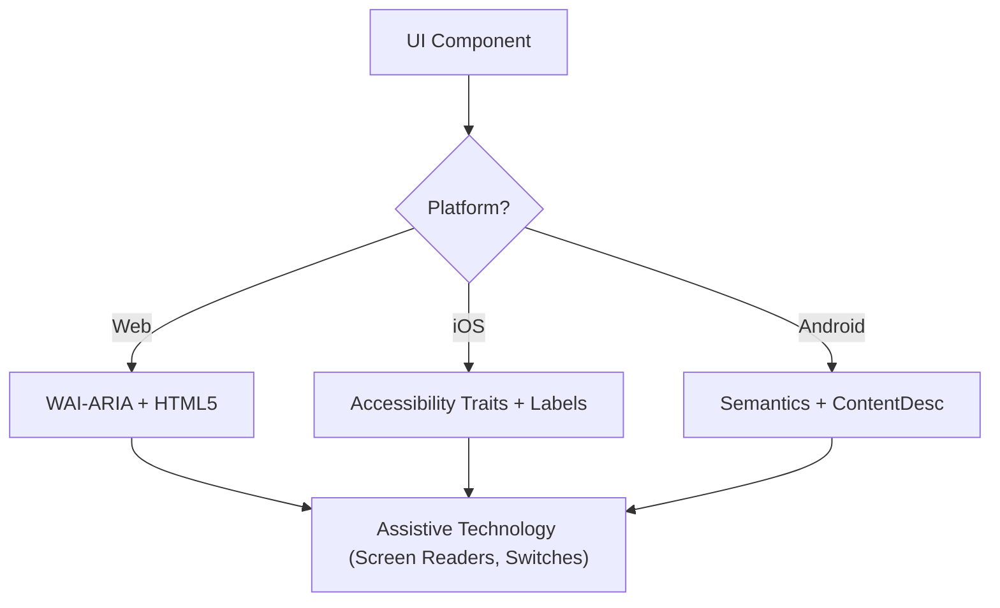

# Accessibility (WCAG 2.2)

這個 skill 確保數位介面對所有使用者都是可感知（Perceivable）、可操作（Operable）、可理解（Understandable）、穩健（Robust）的（POUR），包含使用螢幕閱讀器、開關控制或鍵盤導覽的人。它聚焦在 WCAG 2.2 成功準則的技術實作。

## When to Use

- 為 Web、iOS 或 Android 定義 UI 元件規格。
- 稽核現有程式碼的無障礙障礙或合規缺口。
- 實作像 Target Size (Minimum) 和 Focus Appearance 這類新的 WCAG 2.2 標準。
- 把高層的設計需求對應到技術屬性（ARIA role、trait、提示）。

## Core Concepts

- **POUR 原則**：WCAG 的基礎（Perceivable、Operable、Understandable、Robust）。
- **語意對應**：用原生元素取代通用容器，以取得內建的無障礙功能。
- **Accessibility Tree**：輔助技術真正會「讀取」的 UI 表示。
- **Focus 管理**：控制鍵盤／螢幕閱讀器游標的順序和可見性。
- **標籤與提示**：透過 `aria-label`、`accessibilityLabel` 和 `contentDescription` 提供脈絡。

## How It Works

### Step 1: Identify the Component Role

判斷功能用途（例如：這是 button、link，還是 tab？）。在退而使用自訂 role 之前，先用現有最語意化的原生元素。

### Step 2: Define Perceivable Attributes

- 確保文字對比符合 **4.5:1**（一般）或 **3:1**（大字／UI）。
- 為非文字內容（圖片、圖示）加上文字替代。
- 實作響應式 reflow（放大到 400% 仍不失去功能）。

### Step 3: Implement Operable Controls

- 確保點擊目標至少 **24x24 CSS pixel**（WCAG 2.2 SC 2.5.8）。
- 驗證所有互動元素都能用鍵盤到達，而且有可見的 focus 指示（SC 2.4.11）。
- 為拖曳動作提供單一指標的替代方式。

### Step 4: Ensure Understandable Logic

- 使用一致的導覽模式。
- 提供描述性的錯誤訊息和修正建議（SC 3.3.3）。
- 實作「Redundant Entry」（SC 3.3.7），避免兩次要求同樣的資料。

### Step 5: Verify Robust Compatibility

- 使用正確的 `Name, Role, Value` 模式。
- 為動態狀態更新實作 `aria-live` 或 live region。

## Accessibility Architecture Diagram



## Cross-Platform Mapping

| 功能            | Web (HTML/ARIA)          | iOS (SwiftUI)                        | Android (Compose)                                           |
| :----------------- | :----------------------- | :----------------------------------- | :---------------------------------------------------------- |
| **主要標籤**  | `aria-label` / `<label>` | `.accessibilityLabel()`              | `contentDescription`                                        |
| **次要提示** | `aria-describedby`       | `.accessibilityHint()`               | `Modifier.semantics { stateDescription = ... }`             |
| **動作 role**    | `role="button"`          | `.accessibilityAddTraits(.isButton)` | `Modifier.semantics { role = Role.Button }`                 |
| **即時更新**   | `aria-live="polite"`     | `.accessibilityLiveRegion(.polite)`  | `Modifier.semantics { liveRegion = LiveRegionMode.Polite }` |

## Examples

### Web: Accessible Search

```html
<form role="search">
  <label for="search-input" class="sr-only">Search products</label>
  <input type="search" id="search-input" placeholder="Search..." />
  <button type="submit" aria-label="Submit Search">
    <svg aria-hidden="true">...</svg>
  </button>
</form>
```

### iOS: Accessible Action Button

```swift
Button(action: deleteItem) {
    Image(systemName: "trash")
}
.accessibilityLabel("Delete item")
.accessibilityHint("Permanently removes this item from your list")
.accessibilityAddTraits(.isButton)
```

### Android: Accessible Toggle

```kotlin
Switch(
    checked = isEnabled,
    onCheckedChange = { onToggle() },
    modifier = Modifier.semantics {
        contentDescription = "Enable notifications"
    }
)
```

## Anti-Patterns to Avoid

- **Div-Buttons**：用 `<div>` 或 `<span>` 處理點擊事件，卻沒有加上 role 和鍵盤支援。
- **只靠顏色傳達意義**：_只_用顏色變化來表示錯誤或狀態（例如把邊框變紅）。
- **沒有限制範圍的 Modal Focus**：Modal 沒有鎖住 focus，讓鍵盤使用者在 modal 開啟時還能瀏覽背景內容。Focus 必須被限制在裡面，_而且_ 能透過 `Escape` 鍵或明確的關閉按鈕離開（WCAG SC 2.1.2）。
- **多餘的 Alt 文字**：在 alt 文字裡使用「Image of...」或「Picture of...」（螢幕閱讀器已經會唸出「Image」這個 role）。

## Best Practices Checklist

- [ ] 互動元素符合 **24x24px**（Web）或 **44x44pt**（原生）的點擊目標大小。
- [ ] Focus 指示清楚可見且對比高。
- [ ] Modal 開啟時**鎖住 focus**，關閉時乾淨地釋放（`Escape` 鍵或關閉按鈕）。
- [ ] Dropdown 和選單關閉時，把 focus 還給觸發它的元素。
- [ ] 表單提供文字形式的錯誤建議。
- [ ] 所有只有圖示的按鈕都有描述性的文字標籤。
- [ ] 文字縮放時內容能正確 reflow。

## References

- [WCAG 2.2 Guidelines](https://www.w3.org/TR/WCAG22/)
- [WAI-ARIA Authoring Practices](https://www.w3.org/TR/wai-aria-practices/)
- [iOS Accessibility Programming Guide](https://developer.apple.com/documentation/accessibility)
- [iOS Human Interface Guidelines - Accessibility](https://developer.apple.com/design/human-interface-guidelines/accessibility)
- [Android Accessibility Developer Guide](https://developer.android.com/guide/topics/ui/accessibility)

## Related Skills

- `frontend-patterns`
- `design-system`
- `liquid-glass-design`
- `swiftui-patterns`
