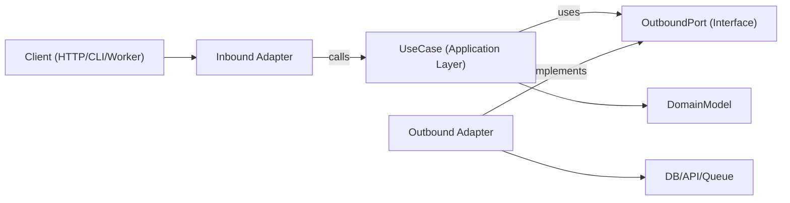

# Hexagonal Architecture

Hexagonal architecture（Ports and Adapters）讓商業邏輯獨立於框架、傳輸層和持久化的細節。核心應用只依賴抽象的 port，由邊界上的 adapter 去實作這些 port。

## When to Use

- 開發新功能，而且長期可維護性和可測試性很重要。
- 重構分層架構或重度依賴框架的程式碼，這類程式的領域邏輯常跟 I/O 混在一起。
- 同一個 use case 要支援多種介面（HTTP、CLI、queue worker、cron job）。
- 要換掉基礎設施（資料庫、外部 API、message bus），但不想重寫商業規則。

只要需求涉及邊界、以領域為中心的設計、重構緊耦合的服務，或把應用邏輯從特定函式庫解耦，就用這個 skill。

## Core Concepts

- **Domain model**：商業規則與 entity / value object。不 import 任何框架。
- **Use cases（application layer）**：編排領域行為和流程步驟。
- **Inbound ports**：描述應用「能做什麼」的契約（command / query / use-case 介面）。
- **Outbound ports**：應用需要的依賴所對應的契約（repository、gateway、event publisher、clock、UUID 等）。
- **Adapters**：port 的基礎設施與對外介面實作（HTTP controller、DB repository、queue consumer、SDK wrapper）。
- **Composition root**：唯一的組裝點，在這裡把具體的 adapter 綁到 use case 上。

Outbound port 介面通常放在 application layer（只有抽象真的屬於領域層級時才放 domain），基礎設施 adapter 則負責實作它們。

依賴方向永遠朝內：

- Adapters -> application/domain
- Application -> port 介面（inbound/outbound 契約）
- Domain -> 只依賴 domain 內的抽象（不依賴框架或基礎設施）
- Domain -> 不依賴任何外部東西

## How It Works

### Step 1: Model a use case boundary

定義單一 use case，有明確的輸入和輸出 DTO。傳輸層的細節（Express 的 `req`、GraphQL 的 `context`、job payload 的包裝）要留在這個邊界外面。

### Step 2: Define outbound ports first

把每個 side effect 都當成一個 port：

- 持久化（`UserRepositoryPort`）
- 外部呼叫（`BillingGatewayPort`）
- 橫切關注點（`LoggerPort`、`ClockPort`）

Port 要描述「能力」，不要描述「技術」。

### Step 3: Implement the use case with pure orchestration

Use case 的 class / function 透過 constructor 或參數接收 port。它驗證應用層級的 invariant、協調領域規則，然後回傳單純的資料結構。

### Step 4: Build adapters at the edge

- Inbound adapter 把協定的輸入轉成 use-case 的輸入。
- Outbound adapter 把應用的契約對應到具體的 API / ORM / query builder。
- 對應（mapping）留在 adapter 裡，不要放進 use case。

### Step 5: Wire everything in a composition root

先建立 adapter，再注入到 use case。把這段組裝集中管理，避免出現隱藏的 service-locator 行為。

### Step 6: Test per boundary

- 用 fake port 對 use case 做 unit test。
- 用真實的基礎設施依賴對 adapter 做 integration test。
- 透過 inbound adapter 對使用者面對的流程做 E2E test。

## Architecture Diagram



## Suggested Module Layout

用 feature-first 的方式組織，邊界要明確：

```text
src/
  features/
    orders/
      domain/
        Order.ts
        OrderPolicy.ts
      application/
        ports/
          inbound/
            CreateOrder.ts
          outbound/
            OrderRepositoryPort.ts
            PaymentGatewayPort.ts
        use-cases/
          CreateOrderUseCase.ts
      adapters/
        inbound/
          http/
            createOrderRoute.ts
        outbound/
          postgres/
            PostgresOrderRepository.ts
          stripe/
            StripePaymentGateway.ts
      composition/
        ordersContainer.ts
```

## TypeScript Example

### Port definitions

```typescript
export interface OrderRepositoryPort {
  save(order: Order): Promise<void>;
  findById(orderId: string): Promise<Order | null>;
}

export interface PaymentGatewayPort {
  authorize(input: { orderId: string; amountCents: number }): Promise<{ authorizationId: string }>;
}
```

### Use case

```typescript
type CreateOrderInput = {
  orderId: string;
  amountCents: number;
};

type CreateOrderOutput = {
  orderId: string;
  authorizationId: string;
};

export class CreateOrderUseCase {
  constructor(
    private readonly orderRepository: OrderRepositoryPort,
    private readonly paymentGateway: PaymentGatewayPort
  ) {}

  async execute(input: CreateOrderInput): Promise<CreateOrderOutput> {
    const order = Order.create({ id: input.orderId, amountCents: input.amountCents });

    const auth = await this.paymentGateway.authorize({
      orderId: order.id,
      amountCents: order.amountCents,
    });

    // markAuthorized 會回傳新的 Order instance，不會原地修改。
    const authorizedOrder = order.markAuthorized(auth.authorizationId);
    await this.orderRepository.save(authorizedOrder);

    return {
      orderId: order.id,
      authorizationId: auth.authorizationId,
    };
  }
}
```

### Outbound adapter

```typescript
export class PostgresOrderRepository implements OrderRepositoryPort {
  constructor(private readonly db: SqlClient) {}

  async save(order: Order): Promise<void> {
    await this.db.query(
      "insert into orders (id, amount_cents, status, authorization_id) values ($1, $2, $3, $4)",
      [order.id, order.amountCents, order.status, order.authorizationId]
    );
  }

  async findById(orderId: string): Promise<Order | null> {
    const row = await this.db.oneOrNone("select * from orders where id = $1", [orderId]);
    return row ? Order.rehydrate(row) : null;
  }
}
```

### Composition root

```typescript
export const buildCreateOrderUseCase = (deps: { db: SqlClient; stripe: StripeClient }) => {
  const orderRepository = new PostgresOrderRepository(deps.db);
  const paymentGateway = new StripePaymentGateway(deps.stripe);

  return new CreateOrderUseCase(orderRepository, paymentGateway);
};
```

## Multi-Language Mapping

各個生態系都用同一套邊界規則，只有語法和組裝風格不同。

- **TypeScript/JavaScript**
  - Ports：`application/ports/*`，用 interface / type。
  - Use cases：用 constructor 或參數注入的 class / function。
  - Adapters：`adapters/inbound/*`、`adapters/outbound/*`。
  - Composition：明確的 factory / container 模組（不要有隱藏的全域變數）。
- **Java**
  - Packages：`domain`、`application.port.in`、`application.port.out`、`application.usecase`、`adapter.in`、`adapter.out`。
  - Ports：放在 `application.port.*` 的 interface。
  - Use cases：普通的 class（Spring 的 `@Service` 可有可無，不是必要）。
  - Composition：Spring config 或手動組裝的 class；組裝邏輯不要放進 domain / use-case class。
- **Kotlin**
  - Module / package 照 Java 的切法（`domain`、`application.port`、`application.usecase`、`adapter`）。
  - Ports：Kotlin interface。
  - Use cases：用 constructor 注入的 class（Koin / Dagger / Spring / 手動都行）。
  - Composition：module 定義或專門的 composition function；避免 service locator 模式。
- **Go**
  - Packages：`internal/<feature>/domain`、`application`、`ports`、`adapters/inbound`、`adapters/outbound`。
  - Ports：小型 interface，由使用它的 application package 持有。
  - Use cases：有 interface 欄位的 struct，加上明確的 `New...` constructor。
  - Composition：在 `cmd/<app>/main.go`（或專門的 wiring package）裡組裝，constructor 保持明確。

## Anti-Patterns to Avoid

- Domain entity import ORM model、web 框架型別或 SDK client。
- Use case 直接讀 `req`、`res` 或 queue metadata。
- Use case 沒經過 domain / application 的 mapping，就直接回傳資料庫的 row。
- 讓 adapter 彼此直接呼叫，而不是透過 use-case port 流動。
- 把依賴組裝分散在很多檔案裡，還藏著全域 singleton。

## Migration Playbook

1. 挑一個常常改得很痛的垂直切片（單一 endpoint / job）。
2. 抽出一個 use-case 邊界，輸入輸出型別要明確。
3. 在現有的基礎設施呼叫外面加上 outbound port。
4. 把編排邏輯從 controller / service 搬進 use case。
5. 舊的 adapter 留著，但讓它們委派給新的 use case。
6. 在新邊界周圍補測試（unit + adapter integration）。
7. 一個切片一個切片重複做，避免整個重寫。

### Refactoring Existing Systems

- **Strangler approach**：保留現有 endpoint，一次把一個 use case 導到新的 port / adapter。
- **No big-bang rewrites**：按 feature 切片逐步遷移，並用 characterization test 保住行為。
- **Facade first**：先把舊的 service 包在 outbound port 後面，再去換內部實作。
- **Composition freeze**：儘早把組裝集中起來，免得新依賴漏進 domain / use-case 層。
- **Slice selection rule**：優先處理改動頻繁、爆炸半徑小的流程。
- **Rollback path**：每個遷移完的切片都保留一個可回復的開關或路由切換，直到正式環境的行為確認沒問題。

## Testing Guidance (Same Hexagonal Boundaries)

- **Domain tests**：把 entity / value object 當純商業規則來測（不用 mock，也不用架框架）。
- **Use-case unit tests**：用 outbound port 的 fake / stub 測編排；斷言商業結果和 port 的互動。
- **Outbound adapter contract tests**：在 port 層級定義共用的 contract suite，對每個 adapter 實作都跑一遍。
- **Inbound adapter tests**：驗證協定對應（HTTP / CLI / queue payload 對應到 use-case 輸入，以及輸出和錯誤再對應回協定）。
- **Adapter integration tests**：對真實基礎設施（DB / API / queue）執行，檢查序列化、schema / query 行為、重試和 timeout。
- **End-to-end tests**：涵蓋關鍵使用者流程，從 inbound adapter -> use case -> outbound adapter。
- **Refactor safety**：抽取之前先補 characterization test，等新邊界的行為穩定且等價才拿掉。

## Best Practices Checklist

- Domain 和 use-case 層只 import 內部型別和 port。
- 每個外部依賴都有對應的 outbound port。
- 驗證發生在邊界（inbound adapter + use-case invariant）。
- 用不可變的轉換（回傳新的值 / entity，不要改共用狀態）。
- 錯誤要跨邊界轉譯（infra error -> application/domain error）。
- Composition root 要明確，而且容易稽核。
- Use case 只要用簡單的 in-memory fake 就能測。
- 重構從單一垂直切片開始，並有保住行為的測試。
- 語言和框架的特定細節留在 adapter，絕對不要進到領域規則。
