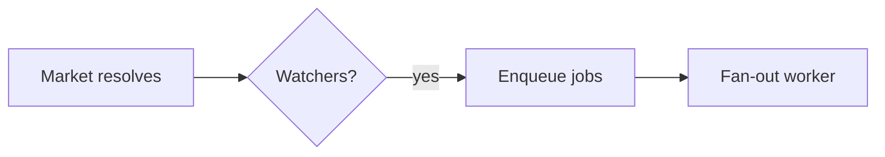

# Plan Canvas

給計畫和視覺化產出物用的 review 迴圈：你寫產出物，人在瀏覽器裡 review，可以標註他指的那個確切元素、聊天，並下達 **Approve plan / Request changes** 的裁決，而你則卡在一個 CLI 呼叫上等，它會把他們的回饋以 JSON 回傳給你。

靈感來自 [lavish-axi](https://github.com/kunchenguid/lavish-axi)；以 ECC 原生的方式，圍繞 `/plan` 的確認 gate 重新打造，零依賴。

## 何時使用

- 你剛寫好一份計畫產出物（`/plan` 產生的 `.claude/plans/*.plan.md`），需要 CONFIRM/核准的決定，canvas 上的裁決取代手打的「好/繼續」。
- 使用者應該*用指的*來說要改什麼：review 設計稿、比較表、報告，或任何本機的 `.md` / `.html` 產出物。
- 使用者要求 `/plan-canvas`、視覺化 review，或說「在瀏覽器裡打開」。

**不要**用在：diff 的 code review（用 `/code-review`）、執行 web 應用程式，或遠端 URL。canvas 只提供本機的產出物檔案。

## 運作方式

用 `ecc-plan-canvas` 呼叫這個 CLI，它是 `ecc-universal` 套件附帶的 bin（全域/plugin 安裝後會在 PATH 上；plugin 安裝時用 `node "$CLAUDE_PLUGIN_ROOT/scripts/plan-canvas.js"` 也可以）。從你正在 review 的專案裡執行；任何工作目錄都能跑。它會管理一個脫離終端的 loopback server（`127.0.0.1:4517`），所有 session 共用，以產出物路徑為 key，不用追蹤 session id。

整個流程就是單純的 CLI 加 JSON 迴圈，所以跟模型和 harness 無關：任何能執行 shell 指令、讀 stdout 的 agent，驅動方式都一樣（Claude Code、Codex、Cursor、Gemini、OpenCode、Copilot）。用你的 harness 提供 skill 的方式觸發它，例如 Claude Code 的 `/plan-canvas`、Codex 的 `$plan-canvas`，或直接跑 `ecc-plan-canvas` 指令。

```bash
# 1. 在使用者的瀏覽器裡開啟產出物（會立刻返回）
ecc-plan-canvas open .claude/plans/feature.plan.md

# 2. 阻塞等到人回應。讓它一直跑；被中斷就重跑：
#    排隊中的回饋不會遺失。
ecc-plan-canvas await .claude/plans/feature.plan.md
```

### 保持在聽，不然人是在對著空椅子講話

回饋只有在 `await` 真的掛在 session 上的時候才送得到你手上。如果你這一輪結束了，卻沒有任何東西在聽，訊息就會留在佇列裡，從人這一邊的玻璃看出去，送出去彷彿什麼事都沒發生。

所以如果你的 harness 支援背景任務，就把 `await` **當成背景任務來跑**（在 Claude Code 裡，就是 `run_in_background: true` 的 Bash 呼叫）。它在回饋抵達的瞬間就會結束，harness 把 JSON 交給你，這樣迴圈就能跨回合保持運作，不會隨著前景呼叫一起死掉。前景的 `await` 也能用，但只撐到 harness 對它設的時間限制為止。

有兩道保險，但都不是可以省略上面那段的藉口：

- `ecc-plan-canvas pending` 會列出排隊中、沒人在聽的回饋。只要不確定自己有沒有漏掉東西，就檢查它。
- `stop:plan-canvas-pending` hook 會在 canvas 回饋還沒送達時，擋住你這一輪結束，並把訊息交給你。如果你是從那個 hook 讀到回饋的，就代表你太早停止在聽了。

人一有動作，`await` 就會印出 JSON：

```json
{
  "status": "feedback",
  "items": [
    { "kind": "annotation", "text": "Split this into two phases",
      "anchor": { "selector": "h2:nth-of-type(3)", "tag": "h2", "snippet": "Phase 2: Migration" } },
    { "kind": "verdict", "verdict": "request-changes" }
  ]
}
```

- `kind: "chat"`：自由格式的訊息；在 canvas 裡回答，不要在終端機回答。
- `kind: "annotation"`：錨定在某個元素上的回饋（`anchor.selector`、`anchor.snippet` 顯示他們指的是什麼；如果他們標了一段文字，就會有 `anchor.textRange.text`）。
- `kind: "verdict"`：`approve` 表示計畫已 CONFIRMED：停止輪詢、結束 session，開始實作。`request-changes` 表示要修改產出物（canvas 會 live-reload），並讓迴圈繼續。

**3. 一律在 canvas 裡回應**，然後繼續聽。一個指令就能兩件事一起做：

```bash
ecc-plan-canvas await <file> --reply "Split Phase 2 as requested. Take a look."
```

人傳的每則訊息都要在 canvas 裡回覆，就算只是一句「收到，我現在重寫風險表。」也要。聊天面板沒有任何回應，跟 canvas 壞掉看起來一模一樣，而這正是這個迴圈要防止的失敗。要在那裡回答，不要只在終端機回答。

工作的時候，用活動指示器讓聊天室保持誠實：

```bash
# 動畫式的「agent 思考中...」泡泡；長時間工作時要刷新它
ecc-plan-canvas typing <file> --state thinking
# 在回覆送出之前，切換成「agent 輸入中...」
ecc-plan-canvas typing <file> --state typing
```

`await` 在把一批回饋交給你的當下，會自動幫你設成 `thinking`，而 `--reply` 會清掉它。這兩種狀態都會自己過期，所以 agent 當掉的話，會退回成誠實的「排隊中」，不會讓人一直盯著跳動的點點看。如果一次修改要花超過一分鐘，就刷新 `thinking`。

**4. 結束**：review 結束時執行 `ecc-plan-canvas end <file>`。

## 圖表（Mermaid）

當計畫的某個部分是流程、架構、時序、狀態機、ER 模型或依賴圖時，請用 ` ```mermaid ` 的 fenced block 來寫，不要用 ASCII art 或一大段文字。canvas 會把它渲染成有主題的圖表，讓人可以直接指。圖比一段話讀得更快的時候就用；簡單的清單或表格就不用。

````markdown

````

圖表會用 ECC 的深色主題和強調色渲染。Mermaid 是從瀏覽器載入的、釘住版本的 CDN；如果那邊用不了（離線），這個 block 會退而顯示原始碼，所以 review 永遠不會被卡住。air-gapped 環境可以把 `ECC_PLAN_CANVAS_MERMAID_URL` 指向本地鏡像。

## 規則

- Markdown 產出物會用 ECC 的計畫樣板渲染（包含 Mermaid block）；`.html` 產出物則原樣渲染，並注入標註層。撰寫 HTML 的指引請用 `frontend-design-direction` 和 `artifact-design` 這兩個 skill。
- 要修改就編輯產出物檔案，canvas 會在存檔時 live-reload。絕對不要重跑 `open` 來刷新。
- `{"status": "ended", "endedBy": "user"}`（或回饋批次上的 `sessionEnded: true`）表示使用者關掉了這次 review：停止輪詢，剩下的更新用聊天傳達，不要重新打開。對該 session 單純執行 `open` 會被拒絕；只有使用者要求恢復時，才傳 `--reopen`。
- 同層的資源（圖片、CSS）必須放在產出物旁邊，並用相對路徑引用。
- server 只綁 loopback，閒置 30 分鐘後會自動結束（`ECC_PLAN_CANVAS_IDLE_MS`）；`stop` 可以明確關掉它。狀態存放在 `~/.claude/plan-canvas/`（`ECC_PLAN_CANVAS_STATE_DIR`）。

## 範例

**計畫核准流程**：`/plan` 寫出 `.claude/plans/notifications.plan.md`，而且必須等待確認：

```bash
ecc-plan-canvas open .claude/plans/notifications.plan.md
ecc-plan-canvas await .claude/plans/notifications.plan.md
# → {"status":"feedback","items":[{"kind":"verdict","verdict":"approve"}]}
ecc-plan-canvas end .claude/plans/notifications.plan.md
# 計畫已確認，開始實作
```

**修改迴圈**：回饋進來，你編輯檔案、回覆、繼續聽：

```bash
# await 回傳了標註 → 編輯 .plan.md（canvas 會 live-reload）
ecc-plan-canvas await <file> --reply "Reworked the risk table."
# → 再次阻塞，直到下一次回應
```

## 反模式

- 在迴圈裡用 `--timeout-ms` 輪詢。那是給測試用的。請讓單純的 `await` 一直跑。
- review 還開著的時候，結束你的回合，卻沒有任何 `await` 在聽。這是人會體驗成「我送了訊息，結果什麼事都沒發生」的唯一一種失敗。
- 讀了回饋，卻只在終端機回答。人看的是 canvas。
- 使用者主動結束之後，為了「秀一下」某個東西又重新打開。
- 把整份計畫貼進聊天*又*開 canvas，二選一，選 canvas，終端機的摘要只留一行。
- 從 state 檔案解析 canvas 的聊天內容。你需要的所有東西都會透過 `await` 送達。

設計筆記與由來：[docs/design/plan-canvas.md](../../docs/design/plan-canvas.md)。
