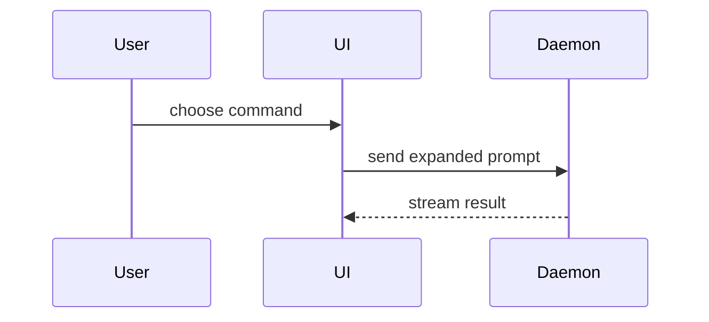

幫使用者用視覺的方式理解目前對話的主題。省略開場白，文字保持簡短。挑最小、能講清楚重點的視圖。

- 邏輯或演算法用 pseudocode 呈現：

```text
on(save)
  if content is unchanged
    return cached result
  write new content
  return fresh result
```

- 執行期的控制流程用 call tree 呈現：

```text
submitForm
  createSession
    persistPrompt
    launchAgent
  navigateToSession
```

- UI 結構用元件樹呈現，包含重要的 state 和模組邊界：

```tsx
<SessionPage> (apps/example/src/routes/session.tsx)
  useSessionEvents()
  <SessionToolbar>
    <RunSkillButton> (packages/ui)
```

- 檔案職責或大範圍的重構，用淺層的檔案樹呈現：

```text
src/
├── commands/       # parses user actions
├── sessions/       # owns session state
└── transport/      # sends API requests
```

- 元件互動、控制流程或資料流，用 Mermaid 呈現：



- 重點是「改了什麼」、而且周圍的形狀已經存在時，用 `diff`。讓 diff 的形狀符合主題。

元件的改動：

```diff
 <SessionPage>
   useSessionEvents()
   <SessionToolbar>
+    <RunSkillButton />
   <SessionTimeline>
+    <SkillResultCard />
```

檔案配置的改動：

```diff
 src/
 ├── commands/
+│   └── show-me.ts       # expands the slash command
 ├── sessions/
-└── transport.ts
+└── transport/
+    ├── client.ts
+    └── stream.ts
```

Call tree 或 call stack 的改動：

```diff
 submitForm
   createSession
     persistPrompt
+    expandSkillMention
     launchAgent
-  navigateToSession
+  navigateToSession
+    subscribeToEvents
```

State 或控制流程的改動：

```diff
 on(save)
-  write content
+  if content is unchanged
+    return cached result
+  write new content
+  invalidate cache
```

- 大部分內容都是新的、省略的 context 會讓人看不出歸屬或順序，或是使用者需要一份可以複製的目標形狀時，呈現完整的區塊：

```ts
function expandSkill(command: string): string {
  const skillName = command.slice(1)
  return `use the ${skillName} skill`
}
```

- 視覺化的 UI、版面、狀態比較，或對 Mermaid 來說太密集的概念，就寫一個聚焦的 HTML 檔案：圖表、資訊圖或簡短的投影片，哪個適合就用哪個。配合產品的顏色、字型、間距和元件；用真實的標籤和資料；同時支援桌面和手機。然後幫使用者打開它：

```
Bash(open path/to/show-me-{description}.html)
```

### guidance

把每個視覺元素放在它所支持的簡短文字旁邊。只保留回答使用者目前問題所需要的呼叫、檔案、props、state 和邊界，或是用來解決目前討論點的各個選項。

你可以只用其中一種，也可以用好幾種，但不太可能全部都用。自己判斷，不要讓使用者被資訊淹沒。
