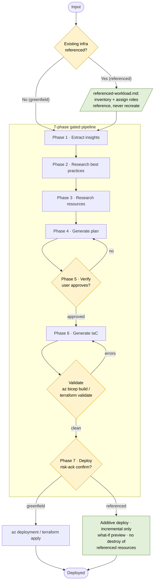

# Azure Enterprise Infra Planner

## 何時使用這個 Skill

使用者想做下面這些事時啟用這個 skill：
- 依工作負載或架構描述規劃企業級 Azure 基礎設施
- 設計 landing zone、hub-spoke 網路或多區域拓撲
- 設計網路基礎設施：VNet、subnet、防火牆、private endpoint、VPN gateway
- 規劃身分、RBAC 和由合規驅動的基礎設施
- 為 subscription 層級或多個 resource group 的部署產生 Bicep 或 Terraform
- 規劃災難復原、failover 或跨區域高可用拓撲

## 快速參考

| 屬性 | 詳細內容 |
|---|---|
| MCP 工具 | `insights_get`, `get_azure_bestpractices_get`, `wellarchitectedframework_serviceguide_get`, `microsoft_docs_fetch`, `microsoft_docs_search`, `bicepschema_get` |
| CLI 指令 | `az deployment group create`, `az bicep build`, `az resource list`, `terraform init`, `terraform plan`, `terraform validate`, `terraform apply`, `checkov` |
| 輸出 schema | [schema.md](references/schema.md) |
| 主要參考 | [workflow.md](references/workflow.md), [waf-checklist.md](references/waf-checklist.md), [resources/](references/resources/README.md), [constraints/](references/constraints/README.md) |

## 工作流程（從這裡開始）

照 [workflow.md](references/workflow.md) 的逐步指示，執行基礎設施規劃和佈建的 7 個階段。

## 架構

這個 skill 跑的是一條 **7 階段、有關卡的 pipeline**。輸入會先分流成兩種流程：

- **Greenfield**：只有新需求，階段一路跑到底。
- **Referenced（brownfield）**：使用者提供了已經存在的東西（一個線上資源／
  resource group／subscription、IaC 或基礎設施計畫，或需求文件）。同樣的階段照跑，另外加上
  [referenced-workload.md](references/referenced-workload.md)：既有資源會被盤點並
  引用（絕不重建），新的工作負載會接到它們上面，而且 **Phase 7 採用累加式部署**
  （只做 incremental，絕不修改或摧毀被引用的資源）。

每個階段都要通過關卡才能往下走。Phase 5 需要使用者明確核准；**Phase 6 是
強化過、會自我驗證的關卡**：產生的 IaC 必須預設就安全，通過本機驗證
（`az bicep build` / `terraform validate`）且零錯誤，通過 `checkov` 安全掃描且沒有
未解決的 high/critical 發現，而且 skill 必須**秀出指令輸出**，並在往下走之前產出完成度
自我檢查；Phase 7 需要使用者明確、並確認過風險的部署確認。

**產出物**（寫在 `<project-root>/` 底下）：`.azure/insights.json`（Phase 1）、
`.azure/infrastructure-plan.json`（Phase 4，狀態 `draft`→`approved`→`deployed`），以及
`infra/main.bicep` + `infra/modules/*` 或 `infra/main.tf` + `infra/modules/**`（Phase 6）。

## MCP 工具

| 工具 | 用途 |
|------|---------|
| `insights_get` | 取得使用者現有 Azure 環境的洞察，輔助規劃決策 |
| `get_azure_bestpractices_get` | 程式碼產生、營運和部署的 Azure 最佳實務 |
| `wellarchitectedframework_serviceguide_get` | 特定 Azure 服務的 WAF 服務指南 |
| `microsoft_docs_search` | 搜尋 Microsoft Learn 的相關文件片段 |
| `microsoft_docs_fetch` | 依 URL 抓取 Microsoft Learn 頁面的完整內容 |
| `bicepschema_get` | 任何 Azure 資源類型的 Bicep schema 定義（最新 API 版本） |

## 錯誤處理

| 錯誤 | 原因 | 修正方式 |
|---|---|---|
| MCP 工具錯誤或不可用 | 工具呼叫 timeout、連線錯誤，或工具不存在 | 重試一次；還是不行就退回用參考檔案，並通知使用者 |
| 缺少 plan 核准 | `meta.status` 不是 `approved` | 停下來，在產生 IaC 或部署之前先請使用者核准 |
| IaC 驗證失敗 | `az bicep build` 或 `terraform validate` 回傳錯誤 | 修正產生的程式碼並重新驗證；還是不行就通知使用者 |
| 配對限制違規 | SKU 或資源組合不相容 | 在進入 IaC 產生之前，先在 plan 裡修好 |
| 找不到 infra plan 或 IaC 檔案 | 檔案寫到錯的位置，或沒有建立 | 確認檔案在 `<project-root>/.azure/` 和 `<project-root>/infra/`；缺的話，嚴格照 [workflow.md](references/workflow.md) 重新建立 |
