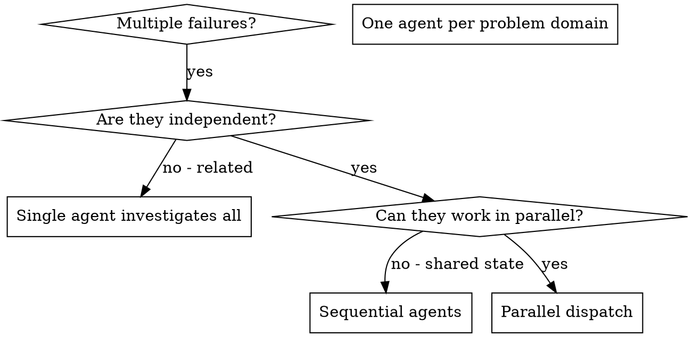

# Dispatching Parallel Agents

## 概述

你把任務委派給 context 隔離的專門 agent。精準地寫好它們的指示和 context，確保它們專注、把任務做好。它們絕對不該繼承你這個 session 的 context 或歷史，你要自己組出它們剛好需要的東西。這樣也能替你自己保留 context，專心做協調的工作。

當你有多個互不相關的失敗（不同的測試檔、不同的子系統、不同的 bug），一個一個依序調查是在浪費時間。每個調查都是獨立的，可以平行進行。

**核心原則：** 每個獨立的問題領域派一個 agent，讓它們同時工作。

## 何時使用



**適合使用：**
- 3 個以上的測試檔失敗，而且 root cause 各不相同
- 多個子系統各自獨立壞掉
- 每個問題不需要其他問題的 context 就能理解
- 各調查之間沒有共享狀態

**不適合使用：**
- 失敗之間有關聯（修好一個可能就修好其他的）
- 需要了解整個系統的狀態
- Agent 之間會互相干擾

## 模式

### 1. 找出獨立的領域

依壞掉的東西把失敗分組：
- 檔案 A 的測試：Tool 核准流程
- 檔案 B 的測試：批次完成的行為
- 檔案 C 的測試：中止功能

每個領域都是獨立的，修好 tool 核准不會影響中止的測試。

### 2. 建立聚焦的 Agent 任務

每個 agent 拿到：
- **明確的範圍：** 一個測試檔或一個子系統
- **清楚的目標：** 讓這些測試通過
- **限制：** 不要改其他程式碼
- **預期輸出：** 你發現什麼、修了什麼的摘要

### 3. 平行派出

在同一個回應裡一次發出這三個 subagent 的派工，它們就會平行執行：

```text
Subagent (general-purpose): "Fix agent-tool-abort.test.ts failures"
Subagent (general-purpose): "Fix batch-completion-behavior.test.ts failures"
Subagent (general-purpose): "Fix tool-approval-race-conditions.test.ts failures"
# All three run concurrently.
```

一個回應裡有多個派工呼叫 = 平行執行。一個回應只放一個 = 依序執行。

### 4. 審查並整合

Agent 回來之後：
- 讀每一份摘要
- 確認修正之間沒有衝突
- 跑完整的測試套件
- 整合所有變更

## Agent Prompt 結構

好的 agent prompt 是：
1. **聚焦的**：一個清楚的問題領域
2. **自給自足的**：包含理解問題所需的所有 context
3. **對輸出很明確的**：agent 該回傳什麼？

```markdown
Fix the 3 failing tests in src/agents/agent-tool-abort.test.ts:

1. "should abort tool with partial output capture" - expects 'interrupted at' in message
2. "should handle mixed completed and aborted tools" - fast tool aborted instead of completed
3. "should properly track pendingToolCount" - expects 3 results but gets 0

These are timing/race condition issues. Your task:

1. Read the test file and understand what each test verifies
2. Identify root cause - timing issues or actual bugs?
3. Fix by:
   - Replacing arbitrary timeouts with event-based waiting
   - Fixing bugs in abort implementation if found
   - Adjusting test expectations if testing changed behavior

Do NOT just increase timeouts - find the real issue.

Return: Summary of what you found and what you fixed.
```

## 常見錯誤

**❌ 太籠統：** 「Fix all the tests」，agent 會迷路
**✅ 明確：** 「Fix agent-tool-abort.test.ts」，範圍聚焦

**❌ 沒有 context：** 「Fix the race condition」，agent 不知道在哪裡
**✅ 有 context：** 貼上錯誤訊息和測試名稱

**❌ 沒有限制：** agent 可能把所有東西都重構一遍
**✅ 有限制：** 「Do NOT change production code」或「Fix tests only」

**❌ 輸出含糊：** 「Fix it」，你不知道改了什麼
**✅ 明確：** 「Return summary of root cause and changes」

## 何時不要使用

**失敗之間有關聯：** 修好一個可能就修好其他的，先一起調查
**需要完整的 context：** 要理解問題必須看到整個系統
**探索式除錯：** 你還不知道是什麼壞了
**共享狀態：** Agent 會互相干擾（編輯同樣的檔案、使用同樣的資源）

## Session 中的真實範例

**情境：** 大規模重構之後，3 個檔案共 6 個測試失敗

**失敗：**
- agent-tool-abort.test.ts：3 個失敗（時序問題）
- batch-completion-behavior.test.ts：2 個失敗（tool 沒有執行）
- tool-approval-race-conditions.test.ts：1 個失敗（執行次數 = 0）

**決定：** 獨立的領域：中止邏輯、批次完成和 race condition 彼此是分開的

**派工：**
```
Agent 1 → Fix agent-tool-abort.test.ts
Agent 2 → Fix batch-completion-behavior.test.ts
Agent 3 → Fix tool-approval-race-conditions.test.ts
```

**結果：**
- Agent 1：把 timeout 換成基於事件的等待
- Agent 2：修好事件結構的 bug（threadId 放錯位置）
- Agent 3：加上等待非同步 tool 執行完成

**整合：** 所有修正都是獨立的，沒有衝突，整套測試全綠

## 驗證

Agent 回來之後：
1. **審查每一份摘要**：了解改了什麼
2. **檢查衝突**：agent 有沒有編輯同一段程式碼？
3. **跑完整套件**：確認所有修正合在一起也能運作
4. **抽樣檢查**：agent 可能會犯系統性的錯誤
