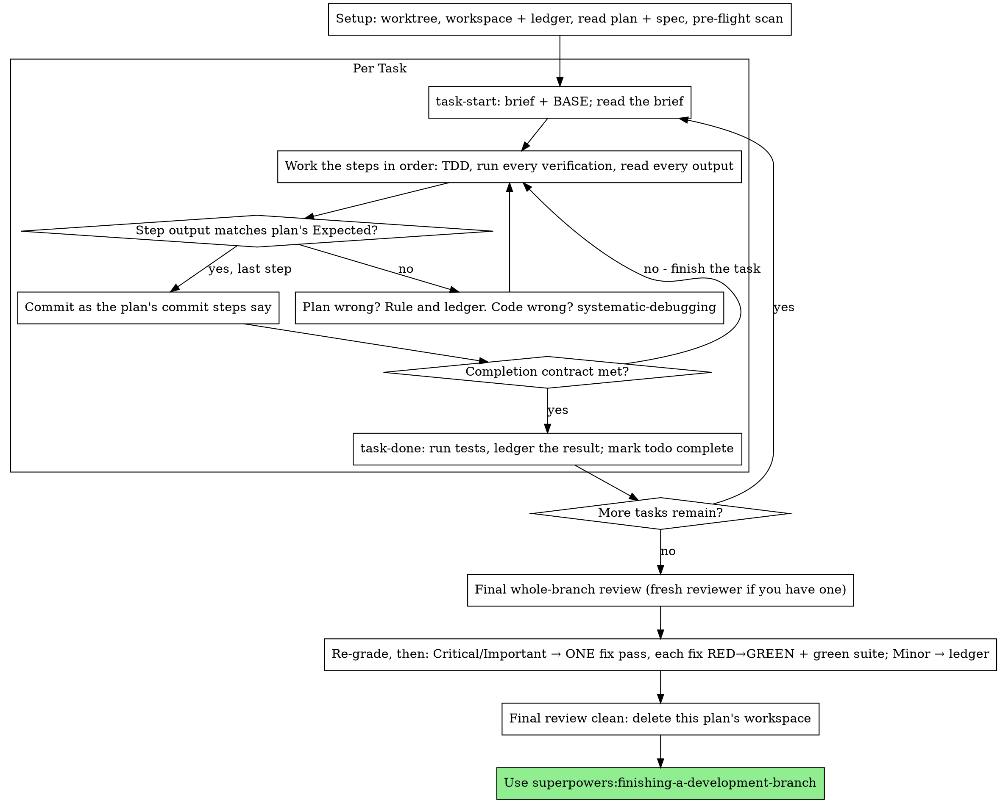

# Executing Plans

在這個 session 裡自己一個任務一個任務地執行計畫：每個任務不派 implementer subagent，也不派 reviewer。最後對整個 branch 做一次全新 context 的審查。

**為什麼用 inline：** Subagent-driven development 每個任務都要付一個全新的 implementer 和一個全新的 reviewer 的成本，它們各自從零開始重讀程式碼庫。Inline 執行只要付一份 context（你的）加上最後一位 reviewer。它放棄的是每個任務一份全新的 context，以及每個任務多一雙眼睛。這個 skill 用別的方式留住了那兩樣東西換來的好處：brief 就是規格，ledger 就是你的記憶，TDD 是每個任務的關卡，最後的 reviewer 就是那第二雙眼睛。

**核心原則：** 計畫已經把腦筋動完了。照它精確地執行，每個步驟都用你親眼看過先失敗、再通過的測試來證明，並留下一份就算你自己忘記也還在的紀錄。

**旁白：** 在 tool call 之間，旁白最多一行短句：ledger 和 tool result 就是紀錄。

**連續執行：** 任務之間不要停下來跟你的搭檔確認。他們選 inline 執行是為了省成本，不是為了在每個任務之後回答「要繼續嗎？」。把計畫裡所有任務一路執行完，不要停。

**要裁決，不要卡住。** 衝突、模糊、計畫缺陷，都由你來決定。規格是有約束力的權威，計畫是它的論述，而兩者都沒回答的，由你的判斷來定。把每個決定記到 ledger，格式是 `Ruling: <what you decided> — <why> — <what it costs if wrong>`，然後繼續往下做。沒有記進 ledger 裡的裁決就偏離計畫，是偷偷做的決定。

只有四件事會讓你停下來，也只有這四件：不可逆或破壞性的操作；牽涉安全性的動作；超出這個 worktree 之外、依慣例應該先問過的副作用（merge、推到共享 branch、發佈）；以及壞到每一條往前的路都只是猜測的計畫。遇到這些就停下來問。

## 何時使用

- 你有一份來自 superpowers:writing-plans 的計畫，而且你的搭檔在交接時選了 inline 執行。
- 你的 harness 沒有 subagent 工具（見 `../using-superpowers/references/` 裡各平台的參考資料）。絕對不要捏造派工動作；就在這裡執行計畫。
- 任務大多是獨立的，前提跟 superpowers:subagent-driven-development 一樣。

規格完整的計畫，會讓 inline 執行變成照抄加上測試：用中階的 session 模型就能跑得很好，而最強的模型值得花錢的唯一地方，就是最後的審查，這個 skill 會另外派它去做。你的搭檔選 inline 的時候，要告訴他們這件事。

當你的搭檔想要每個任務都有審查關卡，或計畫長到後面的任務會在被壓縮過的 context 上跑時，優先選 superpowers:subagent-driven-development。Inline 執行長計畫還是行得通，ledger 就是讓它可以復原的東西，但最後幾個任務得到的你的注意力最少。

## 流程

## 設定

確保工作在隔離的工作區裡進行：用 superpowers:using-git-worktrees 建立一個，或驗證既有的那個。沒有你的搭檔明確同意，絕對不要在 main/master branch 上開始實作。

對話記憶撐不過 compaction。Inline 執行者一旦迷失了進度，就會重新實作那些 commit 早已存在的任務，這跟 controller 重複派工是同一種失敗，只是成本由你自己的 context 來付。把進度記在 ledger 檔案裡，不要只記在 todo 裡。Harness 的 todo 是即時檢視，ledger 才是紀錄。

這個工作區和 ledger 跟 superpowers:subagent-driven-development 共用，同一個目錄、同一種格式，所以計畫可以在執行到一半換執行者，新的執行者從同一份 ledger 接著做。

- 每份計畫都有自己的工作區：skill 一開始，從你正在執行的工作樹，用絕對路徑執行 `../subagent-driven-development/scripts/sdd-workspace PLAN_FILE`，它會印出這份計畫被 git 忽略的目錄（`<repo-root>/.superpowers/sdd/<plan-basename>/`），裡面放著「這份」計畫的所有產物：ledger、brief、審查包。別份計畫的目錄，永遠不是你可以讀寫的。
- 檢查這份計畫的 ledger 在 `<workspace>/progress.md`。如果它的第一行寫的是你的計畫檔案，那麼有 `Task <N>: complete` 這一行的任務就是完成了，不要重做；從第一個沒有這行的任務繼續。它們的 commit 在 git 裡確實存在，即使你的 context 已經不記得自己做過：compaction 之後，要相信 ledger 和 `git log`，不要相信你自己的記憶。第一行寫的是另一個計畫檔案的 ledger，是別份計畫的進度：不要動它，開始你自己全新的那份。
- 建立 ledger 時，第一行寫上它的身分：`# SDD ledger — plan: <plan file path>`。
- `git clean -fdx` 會摧毀這個工作區（它是被 git 忽略的暫存區）；如果發生了，就從 `git log` 復原。

把計畫讀一遍，記下它的 context 和 Global Constraints，並且每個任務建立一個 todo。如果計畫有指名一份 Spec，也要讀：規格是計畫據以論述的權威，計畫內部的衝突要依規格來解決。沒有可取得規格的計畫，要在 ledger 寫一則備註說明這件事：沒有規格時做的裁決是暫時性的。

**必要的子 skill：** 現在就載入 superpowers:test-driven-development，在 Task 1 之前。它管轄下面每個任務的每個步驟；就算計畫的步驟已經寫了「先寫會失敗的測試」，也不能免除你讀它。

Task 1 之前，掃描計畫裡任務之間的衝突。計畫的 Interfaces 區塊會告訴你該看哪裡：對每個消費前面某個任務產出的任務，寫一行 ledger：這兩個任務、其中一個產出什麼對上另一個消費什麼，以及你發現了什麼。什麼都不共享的任務不用寫；整份計畫的任務都不共享東西，就只寫一行 `Pre-flight: no shared interfaces`。每一行揭露出的衝突，以規格為有約束力的權威來裁決，把裁決記在那一行旁邊，然後開始 Task 1。每個任務自己的內文，在你讀它的 brief 時才檢查，不是在這裡。

## 任務迴圈

你印出的所有東西，以及每個 tool result，在 session 剩下的時間裡都會留在你的 context 裡。把很長的測試輸出導到工作區的檔案，再讀它的結尾；讀 brief，不要讀整份計畫。

### 1. 接下任務

- 從你正在執行的工作樹，用絕對路徑執行這個 skill 的 `scripts/task-start PLAN_FILE N`。它一次就會印出 brief 的路徑和 BASE（這個任務的範圍是從哪個 commit 切出來的）。每個任務都要讀 brief，包括你記得在設定時看過的那些：你記得的是摘要，brief 裡才有確切的值、簽章和測試案例。
- 把這個任務的 todo 標為 in_progress。

每一次 tool call 都是一個 turn，會重讀你整個 context。雜務要搭著工作一起做：ledger 的追加和 commit 放在同一次 call 裡，絕對不要單獨為它開一次 call。

### 2. 執行步驟

計畫的步驟已經是 RED-GREEN 的順序；在設定時載入的 superpowers:test-driven-development 之下，照那個順序執行。測試步驟的程式碼先寫、先跑。看著它失敗是一個步驟，不是形式：一個在實作出現之前就通過的測試，是關於那個測試的一項發現。

每個會執行指令的步驟都有一行 `Expected:`。執行指令、讀它的輸出，然後比較。三種結果：

- **符合。** 進入下一步。
- **程式碼錯了。** 用 superpowers:systematic-debugging。找出原因；絕對不要為了讓步驟的輸出符合，而去修補表面症狀。
- **計畫錯了**：某個步驟跟規格矛盾、前面任務的某個 interface 跟這個任務所消費的不符、或某個指令不可能成功。裁決出能滿足規格的最小改動，把它記到 ledger，格式是 `Task <N>: Ruling: <finding> — <what you decided and why>`，然後繼續。這個裁決是被帶著走的，不是靠記憶：後面碰到同一個 interface 的任務會從 ledger 讀到它。

照計畫的 commit 步驟去 commit。一個任務橫跨好幾個 commit 沒問題；審查範圍是從 BASE 切出來的，絕對不是 `HEAD~1`。

### 3. 完成契約

在一個任務寫進 ledger 那一行之前，下面全部都要為真，而且在這個 session 裡有證據，不是從 diff 看起來沒問題就推斷：

- Brief 點名的每個測試都存在、在這個任務中跑過，而且你讀過輸出。
- 這個任務最後一次測試執行通過：`task-done` 就是那次執行，它會把指令和結果寫進 ledger 那一行。
- Brief 裡每一行 `Expected:` 都已經拿真實輸出比對過。
- 每一處偏離 brief 的地方，在 ledger 裡都有一行 `Ruling:`。

**必要的子 skill：** superpowers:verification-before-completion 管轄這個宣稱。只要缺了任何一項，這個任務就沒有完成：把它做完。

### 4. 完成任務

從你正在執行的工作樹，用絕對路徑執行這個 skill 的 `scripts/task-done PLAN_FILE N BASE -- <test command>`，測試指令用 brief 為整個任務指名的那一個。它會執行測試、把完整輸出留在工作區、印出結尾，而且只有在測試通過時，才把完成那一行追加到 ledger：

`Task <N>: complete (commits <base7>..<head7>, tests: <command> → <result>)`

失敗的執行什麼都不會記錄；這個任務就沒有完成。記錄下來之後，把 todo 標為 complete，接著做下一個任務。

## 最終審查

從你正在執行的工作樹，用絕對路徑執行 `../subagent-driven-development/scripts/review-package PLAN_FILE MERGE_BASE HEAD`（MERGE_BASE = 這個 branch 開始的那個 commit，例如 `git merge-base main HEAD`），然後根據它印出的檔案來審查。

**有 subagent 工具的話：** 用可用的最強模型派出 reviewer，因為整個 branch 的審查是判斷型的任務。使用 superpowers:requesting-code-review 的 [code-reviewer.md](../requesting-code-review/code-reviewer.md)，附上審查包的路徑、計畫和規格的路徑、計畫的 Review Focus 區段原文（如果有的話，也就是計畫的測試沒有涵蓋到的輸入類別和失敗模式，reviewer 會逐一刻意檢查），以及指向 ledger 中 `Ruling:` 那幾行的指標，讓它能衡量你做過的決定。要明確指定模型；省略的話，會繼承 session 的模型，那不一定是最強的。這是整趟執行買到的唯一一份全新 context。不要跳過它，也不要用你自己讀 diff 來取代它。

**沒有 subagent 工具的話：** 讀 code-reviewer.md，並對著審查包自己做那次審查，當成最後一個任務的 ledger 那一行之後的獨立一輪。在 ledger 寫下 `Final review: self-review (no subagent tool)`，並在你最後的訊息裡講出來：作者自己審自己，比全新的 reviewer 弱，merge 之前，你的搭檔要決定這樣夠不夠。

在你對任何發現採取行動之前，先把它們分類。Reviewer 的嚴重程度標籤只是建議；關卡由你把關。它的「Declined to judge」清單也歸你處理：那裡的每一行，都是你要做出並記入 ledger 的裁決，跟計畫衝突一模一樣：`Final: Ruling: <behavior the reviewer set aside> — <what a reasonable person using this software gets, and why that stands or why it is now a finding> — <cost if wrong>`。先依影響重新評級：規格是一份願景文件，一項發現的等級，是如果它上線了，一位合理的使用者會得到什麼，而不是規格有沒有點名觸發它的輸入；一位 reviewer 因為規格沒提就把發現定為 Minor，評的是規格，不是影響。然後：

- **Critical 和 Important** 進入修正輪。
- **Minor** 以 `Final: minor (deferred): <one-liner>` 記入 ledger，並放進你最後訊息的「Deferred minors」之下。Minor 永遠不進修正輪，也永遠不會變成裁決：裁決是針對衝突做的決定，不是用來記錄你婉拒了一項修飾建議。

自己修 Critical 和 Important 的發現，這裡你就是 implementer，而且只做「一輪」。每個修正都用 TDD 來驗證，不是靠第二位 reviewer：寫出能重現該發現的測試、看著它失敗、讓它通過，再跑整個測試套件。把每一項記入 ledger，格式是 `Final: fixed <finding> — <test name> RED→GREEN, suite <N>/<N>`。沒有先失敗過的測試的修正，不算驗證過；這一輪結束後套件沒有全綠，表示這一輪還沒結束。不要派出重新審查：那只會重讀一份 diff，而它的涵蓋測試已經回答了「有處理」，它的套件執行也已經回答了「沒有弄壞任何東西」。

你決定不修的發現是一個裁決：`Final: Ruling: <finding> — <why the code stands> — <cost if wrong>`，而且會出現在給你的搭檔的裁決清單裡。沒有第二輪修正。

## 收尾

刪除任何東西之前，把 ledger 裡所有包含 `Ruling:` 的行，收集到你最後訊息的「Rulings I made」之下，依你做出的順序，每一項都附上如果錯了的代價；並把每一行 `minor (deferred)` 放到「Deferred minors」之下。兩份清單都要完整無遺漏。你最後的訊息，是你代替搭檔做的決定，以及你選擇不處理的發現，唯一能傳達到他們那邊的地方。

當最終審查乾淨、修正也都 commit 了，就刪除這份計畫的工作區目錄，現在 git 歷史就是紀錄。同層的其他目錄屬於別的計畫；別去動它們。

使用 superpowers:finishing-a-development-branch。

## 常見的合理化藉口

| 藉口 | 現實 |
|--------|---------|
| 「我記得 Task N 寫什麼」 | 你記得的是摘要。Brief 裡才有確切的值。去讀。 |
| 「計畫的程式碼是對的，不用看測試失敗」 | 你從沒看過失敗的測試什麼都證明不了。那是一個步驟。去跑它。 |
| 「我最後再跑整套測試，不用每個步驟都跑」 | 每個步驟都跑，你才知道是哪一步弄壞的。任務結束時的那次執行是契約，不是替代品。 |
| 「計畫在這裡錯了，我直接做對的事就好」 | 做對的事，並把裁決記進 ledger。沒記進 ledger 的偏離，是偷偷做的決定。 |
| 「我做完幾個任務再寫 ledger」 | Compaction 不會等一個方便的時機。每個任務一行，跟 commit 放在同一則訊息裡。 |
| 「下個任務之前先跟他們確認一下」 | 他們選 inline 是為了省成本。進度詢問花掉的是他們的時間。只有那四個停止條件能讓你停下來。 |
| 「我很仔細地讀過自己的 diff，最後的 reviewer 是多餘的」 | 同一個作者，同樣的盲點。Reviewer 是這趟執行買到的唯一一份全新 context。 |
| 「測試應該會過，這個改動很小」 | 「應該」不是證據。契約要求的是指令和它的輸出。 |
| 「Subagent 又慢又貴，最後的審查我也跳過」 | Inline 已經拿掉每個任務的 reviewer 了。對整個 branch 審查一次是底線，不是上限。 |
| 「Reviewer 說是 Minor，那就是 Minor」 | 那個標籤評的是規格的沉默。要評使用者會得到什麼。先重新評級，再把關。 |
| 「修法很明顯，不用先寫會失敗的測試」 | 會失敗的測試，是證明這個發現是真的、而且現在已經不見了的唯一證據。沒有它，你只有一份 diff 和一點希望。 |
| 「我順便把 minor 也修一修」 | 你修的每個 minor，都是你的搭檔沒要求的一個測試、一個修正和一次套件執行。把它們記進 ledger；由你的搭檔決定。 |
