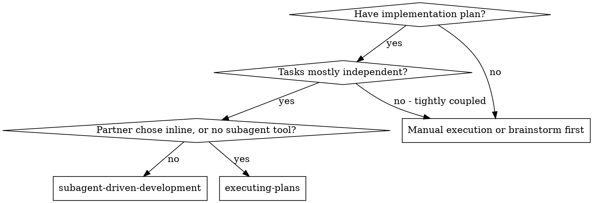
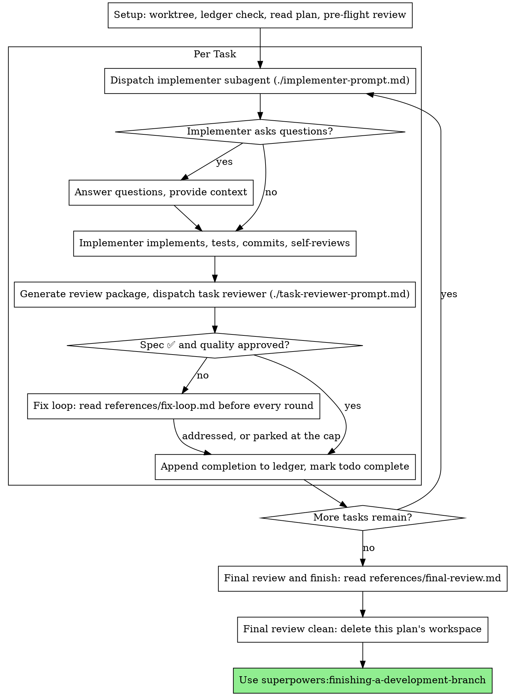

# Subagent-Driven Development

執行計畫的方式：每個任務派一個全新的 implementer subagent，每個任務之後做一次任務審查（規格符合度 + 程式碼品質），最後再做一次涵蓋整個 branch 的廣泛審查。

**為什麼用 subagent：** 你把任務委派給 context 隔離的專門 agent。精準地寫好它們的指示和 context，確保它們專注、把任務做好。它們絕對不該繼承你這個 session 的 context 或歷史，你要自己組出它們剛好需要的東西。這樣也能替你自己保留 context，專心做協調的工作。

**核心原則：** 每個任務一個全新的 subagent + 任務審查（規格 + 品質）+ 廣泛的最終審查 = 高品質、快速迭代

**旁白：** 在 tool call 之間，旁白最多一行短句：ledger 和 tool result 就是紀錄。

**連續執行：** 任務之間不要停下來跟你的搭檔確認。把計畫裡所有任務一路執行完，不要停。唯一能停下來的理由，是下面指名的那四個，或是所有任務都完成了。「要繼續嗎？」的詢問和進度摘要，都是在浪費他們的時間：他們要你執行計畫，那就去執行。

**要裁決，不要卡住。** 一個正在跑的計畫，不會等人。衝突、模糊、計畫缺陷，或是你原本會想請示超過的上限，都由你來決定。規格是有約束力的權威，計畫是它的論述，而兩者都沒回答的，由你的判斷來定。把每個決定記到 ledger，格式是 `Ruling: <what you decided> — <why> — <what it costs if wrong>`，然後繼續往下做。錯誤的裁決，代價是你的搭檔看得到、也能復原的重工；一個卡在某個問題上的 session，代價是他們一整天，而且什麼都買不到。

只有四件事會讓你停下來，也只有這四件：不可逆或破壞性的操作；牽涉安全性的動作；超出這個 worktree 之外、依慣例應該先問過的副作用（merge、推到共享 branch、發佈）；以及壞到每一條往前的路都只是猜測的計畫。遇到這些就停下來問。

## 何時使用

**跟 Executing Plans（inline）比較：**
- 每個任務一個全新的 subagent（沒有 context 污染），而不是一份 context 做完所有任務
- 每個任務之後都審查（規格符合度 + 程式碼品質），而不是只在最後審查
- 成本是每個任務、每次審查各一份全新的 context；inline 的成本是一份 context 加上最後一位 reviewer
- 兩者都在這個 session 裡執行、共用同一個計畫工作區和 ledger，而且任務之間都不暫停

## 流程

## 設定

確保工作在隔離的工作區裡進行：用 superpowers:using-git-worktrees 建立一個，或驗證既有的那個。沒有你的搭檔明確同意，絕對不要在 main/master branch 上開始實作。

對話記憶撐不過 compaction。在真實的 session 裡，迷失了進度的 controller，曾經把整串已完成的任務重新派工，這是觀察到最貴的單一失敗。把進度記在 ledger 檔案裡，不要只記在 todo 裡。

- 每份計畫都有自己的工作區：skill 一開始，從你正在執行的工作樹，用絕對路徑執行這個 skill 的 `bash scripts/sdd-workspace PLAN_FILE`，它會印出這份計畫被 git 忽略的目錄（在 `<repo-root>/.superpowers/sdd/` 底下），裡面放著「這份」計畫的所有產物：ledger、brief、報告、審查包。別份計畫的目錄，永遠不是你可以讀寫的。
- 檢查這份計畫的 ledger 在 `<workspace>/progress.md`。如果有的話，先讀 [references/resuming.md](references/resuming.md)，其他什麼都先別做：它會告訴你這份 ledger 是誰的，以及從哪裡接著做。
- 建立 ledger 時，第一行寫上它的身分：`# SDD ledger — plan: <plan file path>`。
- Ledger 是你的復原地圖：它點名的 commit 在 git 裡確實存在，即使你的 context 已經不記得自己建立過。compaction 之後，要相信 ledger 和 `git log`，不要相信你自己的記憶。
- `git clean -fdx` 會摧毀這個工作區（它是被 git 忽略的暫存區）；如果發生了，就從 `git log` 復原。

把計畫讀一遍，記下它的 context 和 Global Constraints，並且每個任務建立一個 todo。如果計畫有指名一份 Spec，也要讀：規格是計畫據以論述的權威，計畫內部的衝突要依規格來解決。沒有可取得規格的計畫，要在 ledger 寫一則備註說明這件事：沒有規格時做的裁決是暫時性的。

派出 Task 1 之前，先讀 [references/preflight.md](references/preflight.md)，並執行它描述的衝突掃描。它的表格和裁決都要記到 ledger。

## 模型選擇

每個角色都用能勝任的最不強的模型，以節省成本、加快速度。

**機械式的實作任務**（獨立的函式、規格清楚、1-2 個檔案）：用快速、便宜的模型。計畫規格寫得好的時候，大多數實作任務都是機械式的。

**整合和判斷型任務**（多檔案協調、模式比對、除錯）：用標準模型。

**架構和設計任務**：用可用的最強模型。最後涵蓋整個 branch 的審查就是其中之一：用可用的最強模型來派它，不要用 session 預設的模型。

**審查任務**：用同樣的判斷來選模型，依 diff 的大小、複雜度和風險來調整。小而機械式的 diff 不需要最強的模型；細微的並行處理變更才需要。針對小修正 diff 的限縮範圍再審查，用便宜到中階的等級。

**修正迴圈的升級（第 4-5 輪）：** 用比卡住的那位 implementer 至少高一級的模型。

**派 subagent 時，一定要明確指定模型。** 省略模型的話，會繼承你 session 的模型，通常是最強也最貴的，這會悄悄讓這一節的規則白費。

**Turn 數比 token 單價更重要。** 實際花費的時間和 context 成本，跟 subagent 花了多少 turn 成正比，而最便宜的模型在多步驟的工作上，常常要多花 2-3 倍的 turn，整體反而更貴。對 reviewer，以及依據文字描述工作的 implementer，用中階模型當底線。當任務的計畫文字裡包含要寫的完整程式碼時，實作就是照抄加上測試：那位 implementer 用最便宜的等級。單一檔案的機械式修正，也用最便宜的等級。

**任務複雜度的訊號（實作任務）：**
- 動到 1-2 個檔案，而且規格完整 → 便宜的模型
- 動到多個檔案，而且有整合上的顧慮 → 標準模型
- 需要設計判斷，或對整個程式碼庫的廣泛理解 → 最強的模型

## 任務迴圈

**小而同型態的工作：** 當計畫列出好幾個橫跨多個檔案、同類型的小修改時，派出它們之前，先讀 [references/batching.md](references/batching.md)。

你貼進派工 prompt 的所有東西，以及 subagent 印回來的所有東西，在 session 剩下的時間裡都會留在你的 context 裡，而且之後每個 turn 都會被重讀。把產物當成檔案交出去。

**等待已派出的 subagent：** 絕對不要用很短的 timeout 去輪詢等待介面，也絕對不要坐著做一次無聲、沒有上限的等待。只要你手邊有本地的工作（更新 ledger、打包下一份審查、讀報告），就繼續做；子 agent 的結果會自己送過來。當你真的閒下來時，用有上限的區間來等（平台允許的話，五到十分鐘），並在區間之間貼一行狀態，然後對帳你還活著的子 agent：列出它們，並去追那些做完卻沒回報的。有上限的區間，保留了長時間等待幾乎所有的效率，同時保證卡住或遺失的子 agent 會在幾分鐘內被發現，而不是 session 結束時才發現。

### 1. 派出 implementer

派工之前記下 BASE（`git rev-parse HEAD`），審查包和修正輪的 diff 都需要它。

- **任務 brief：** 派出 implementer 之前，從你正在執行的工作樹，用絕對路徑執行這個 skill 的 `bash scripts/task-brief PLAN_FILE N`，它會把這個任務的完整文字擷取到一個命名唯一的檔案，並印出路徑。組出的派工內容，要讓 brief 維持是需求的唯一來源。你的派工內容應該包含：(1) 一行說明這個任務在專案中的位置；(2) brief 的路徑，說成「read this first — it is your requirements, with the exact values to use verbatim」；(3) 前面任務的、brief 沒辦法知道的 interface 和決定；(4) 你對 brief 裡你注意到的任何模糊之處的解決方式；(5) 報告檔的路徑和報告契約。確切的值（數字、魔術字串、簽章、測試案例）只出現在 brief 裡。絕對不要讓 subagent 去讀整份計畫檔。
- **報告檔：** 依 brief 來命名 implementer 的報告檔（brief `…/task-N-brief.md` → 報告 `…/task-N-report.md`），並放進派工 prompt。Implementer 把完整的報告寫在那裡，只回傳狀態、commit、一行測試摘要和疑慮。
- 派工 prompt 描述的是一個任務，不是 session 的歷史。不要把累積的先前任務摘要（「Tasks 1-3 之後的狀態」）貼進後面的派工：真實 session 裡有一次派工達到 42k 字元，其中 99% 是貼上去的歷史。全新的 subagent 需要的是它的任務、它碰到的 interface，以及全域限制。其他都不用。
- 派工要帶著不准再派 subagent 的契約（它在 implementer 範本裡）：implementer 絕對不派 subagent，不管是幫手，還是 reviewer。審查由你在報告之後發出。在真實的 session 裡，worker 派生出來的每位 reviewer，都跟 controller 無論如何都會派的任務審查重複，每個任務白白多出一整個審查席位。
- 如果前面的任務把某個發現擱置在這個任務會碰到的區域，派工時要帶上指向那筆 ledger 條目的指標。
- 從派工結果記下 implementer 的 agent 身分：修正迴圈的第 1-3 輪會續用這個 agent。
- 絕對不要平行派出多個實作 subagent（會衝突）。

範本：[implementer-prompt.md](implementer-prompt.md)

### 2. 處理報告

Implementer subagent 會回報四種狀態之一。各自適當地處理：

**DONE：** 產生審查包（從你正在執行的工作樹，用絕對路徑執行 `bash scripts/review-package PLAN_FILE BASE HEAD`，它會印出它寫入的唯一檔案路徑；BASE 是你派出 implementer 之前記下的 commit，絕對不是 `HEAD~1`，那會悄悄丟掉多 commit 任務裡除了最後一個之外的所有 commit），然後用印出的路徑派出任務 reviewer。

**其他任何狀態**（DONE_WITH_CONCERNS、NEEDS_CONTEXT、BLOCKED）：每次拿到都要讀 [references/handling-reports.md](references/handling-reports.md)，並照它做。

如果 implementer 在開始之前或做到一半提問，要清楚、完整地回答，需要的話提供額外的 context，不要催它趕快去實作。

### 3. 審查任務

每個任務的審查，是限定在該任務範圍內的關卡。廣泛的審查只在最後涵蓋整個 branch 時做一次。絕對不要跳過任務審查，也絕對不要接受缺少任何一項判定的報告：規格符合度「和」任務品質都是必須的。Implementer 的自我審查，永遠不能取代任務審查；兩者都需要。

- 把 diff 當成檔案交給 reviewer：從你正在執行的工作樹，用絕對路徑執行這個 skill 的 `bash scripts/review-package PLAN_FILE BASE HEAD`，並把它印出的檔案路徑交給 reviewer（或者在沒有 bash 的情況下：把該範圍的 `git log --oneline`、`git diff --stat` 和 `git diff -U10`，導向同一個命名唯一的檔案）。輸出絕對不會進到你自己的 context，而 reviewer 一次 Read 就能看到 commit 清單、統計摘要，以及帶有上下文的完整 diff。使用你在派出 implementer 之前記下的 BASE，絕對不要用 `HEAD~1`，那會悄悄截斷多 commit 的任務。沒有 diff 檔案，絕對不要派出任務 reviewer。
- **Reviewer 的輸入：** 任務 reviewer 拿到三個路徑：同一份 brief 檔、報告檔和審查包，加上約束這個任務的全域限制。
- 你交給 reviewer 的全域限制區塊，就是它的注意力鏡頭。把有約束力的需求，逐字從計畫的 Global Constraints 區段或規格複製過來：確切的值、確切的格式，以及元件之間明講的關係（「same layout as X」、「matches Y」）。Reviewer 的範本已經帶有流程規則（YAGNI、測試衛生、審查方法），限制區塊是用來放「這個」專案的規格所要求的東西。
- 沒有具體、針對該任務的理由，就不要加上開放式的指令，像是「check all uses」或「run race tests if useful」
- 不要要求 reviewer 重新跑 implementer 已經對同一份程式碼跑過的測試，implementer 的報告就帶有測試證據
- 不要替 reviewer 預先判斷發現：絕對不要指示 reviewer 忽略或不要標記某個特定問題。如果你認為某個發現會是誤報，就讓 reviewer 提出來，在審查迴圈裡裁決它。如果你正在寫的 prompt 裡有「do not flag」、「don't treat X as a defect」、「at most Minor」或「the plan chose」，停下來：你是在預先判斷，通常是為了替自己省掉一輪審查迴圈。
如果 reviewer 回報了「⚠️ Cannot verify from diff」的項目，在你把任務標為完成之前，先讀 [references/cannot-verify.md](references/cannot-verify.md)。

範本：[task-reviewer-prompt.md](task-reviewer-prompt.md)

### 4. 修正迴圈

當審查回報規格 ❌、任何 Critical 或 Important 發現，或是你確認為真正缺口的 ⚠️ 項目時，迴圈就被觸發。

觸發時，讀 [references/fix-loop.md](references/fix-loop.md) 並照它做。每一輪之前都要再讀一次，即使你在這個 session 稍早讀過：它裡面有輪數上限、斷路器，以及每一輪要寫的 ledger 那一行，而你對它的記憶撐不過 compaction。

### 5. 完成任務

當審查結果乾淨，或是每個未解決的發現都在上限時帶著裁決被擱置了，就把完成那一行，跟你其他的雜務放在同一則訊息裡，追加到 ledger：

- `Task <N>: complete (commits <base7>..<head7>, review clean)`
- 斷路器被觸發之後，則寫 `Task <N>: complete (commits <base7>..<head7>, <K> parked)`

然後把 todo 標為 complete，往下走。審查還有 Critical/Important 問題，既沒修好、也沒在上限時帶著裁決被擱置的話，絕對不要進入下一個任務。

## 最終審查

當每個任務都完成時，讀 [references/final-review.md](references/final-review.md) 並照它做。它涵蓋整個 branch 的審查、它那唯一一波修正，以及你怎麼收尾。

## 常見的合理化藉口

| 藉口 | 現實 |
|--------|---------|
| 「規格符合度大致可以了」 | Reviewer 找到規格缺口 = 還沒完成。要嘛修好，要嘛碰到上限後裁決，只有這兩個出口。 |
| 「我自己修就好，派工是多餘的負擔」 | Controller 自己修會污染你的 context，還會跳過審查。續用 implementer。 |
| 「再來一輪就會收斂」 | 超過上限之後，輪次不會收斂：失敗是結構性的。裁決並轉交。 |
| 「Reviewer 反正每次都會找到新東西」 | 限縮範圍的再審查是驗證修正；它們不能到處亂晃。沒動過的程式碼上的新發現，放進 ledger，不要放進迴圈。 |
| 「這個發現顯然是錯的，我把它丟掉」 | 你只有在上限時才能裁決，而且每個裁決都是一筆 ledger 條目。悄悄丟棄是禁止的。 |
| 「修正很小，跳過再審查」 | 沒審查過的修正，就是回歸問題上線的方式。每一輪都以限縮範圍的再審查結束。 |
| 「審查會拖慢迴圈」 | 沒有審查的迴圈，只是沒被驗證的空轉。審查是迴圈的煞車和方向盤。 |
| 「Ledger 的記錄是多餘的負擔」 | Ledger 是撐得過 compaction 的東西。沒有它的 controller，曾經把整串已完成的任務重新派工。 |
| 「Implementer 自己派了 reviewer，等於免費的額外保證」 | 那是對同一份 diff 的重複席位；任務審查才是關卡。Worker 派生的 reviewer 是要標記的缺陷，不是嚴謹。 |
