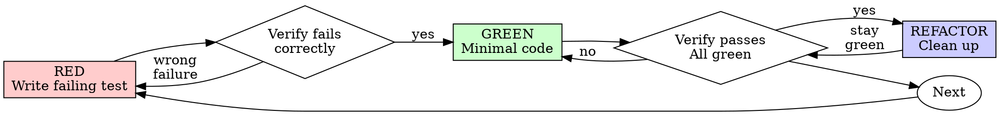

# Test-Driven Development (TDD)

## 概述

先寫測試。看著它失敗。寫最少的程式碼讓它通過。

**核心原則：** 如果你沒看過測試失敗，你就不知道它測的是不是對的東西。

**違反規則的字面規定，就是違反規則的精神。**

## 何時使用

**一律要用：**
- 新功能
- 修 bug
- 重構
- 行為變更

**例外（要問你的搭檔）：**
- 用完即丟的原型
- 產生出來的程式碼
- 設定檔

在想「就這一次跳過 TDD」嗎？停。那是合理化。

## 鐵律

```
NO PRODUCTION CODE WITHOUT A FAILING TEST FIRST
```

測試之前就寫了程式碼？刪掉。重來。

**沒有例外：**
- 不要把它留著當「參考」
- 寫測試的時候不要「改編」它
- 不要去看它
- 刪掉就是刪掉

從測試重新實作。就這樣。

## Red-Green-Refactor



### RED - 寫會失敗的測試

寫一個最小的測試，顯示應該發生什麼。

<Good>
```typescript
test('retries failed operations 3 times', async () => {
  let attempts = 0;
  const operation = () => {
    attempts++;
    if (attempts < 3) throw new Error('fail');
    return 'success';
  };

  const result = await retryOperation(operation);

  expect(result).toBe('success');
  expect(attempts).toBe(3);
});
```
名稱清楚、測真實的行為、只測一件事
</Good>

<Bad>
```typescript
test('retry works', async () => {
  const mock = jest.fn()
    .mockRejectedValueOnce(new Error())
    .mockRejectedValueOnce(new Error())
    .mockResolvedValueOnce('success');
  await retryOperation(mock);
  expect(mock).toHaveBeenCalledTimes(3);
});
```
名稱含糊、測的是 mock，不是程式碼
</Bad>

**需求：**
- 一個行為
- 名稱清楚
- 真實的程式碼（除非不可避免，否則不要用 mock）

### 驗證 RED - 看著它失敗

**必做。絕對不能跳過。**

```bash
npm test path/to/test.test.ts
```

確認：
- 測試是失敗（不是出錯）
- 失敗訊息是預期的
- 失敗是因為功能還不存在（不是打錯字）

**測試通過了？** 你測的是既有的行為。修測試。

**測試出錯？** 修好錯誤，重跑，直到它正確地失敗。

### GREEN - 最少的程式碼

寫出能讓測試通過的最簡單程式碼。

<Good>
```typescript
async function retryOperation<T>(fn: () => Promise<T>): Promise<T> {
  for (let i = 0; i < 3; i++) {
    try {
      return await fn();
    } catch (e) {
      if (i === 2) throw e;
    }
  }
  throw new Error('unreachable');
}
```
剛好夠通過
</Good>

<Bad>
```typescript
async function retryOperation<T>(
  fn: () => Promise<T>,
  options?: {
    maxRetries?: number;
    backoff?: 'linear' | 'exponential';
    onRetry?: (attempt: number) => void;
  }
): Promise<T> {
  // YAGNI
}
```
過度設計
</Bad>

不要加功能、不要重構其他程式碼，也不要在測試之外「改進」。

### 驗證 GREEN - 看著它通過

**必做。**

```bash
npm test path/to/test.test.ts
```

確認：
- 測試通過
- 其他測試仍然通過
- 輸出乾淨（沒有錯誤、警告）

**測試失敗？** 修程式碼，不要修測試。

**其他測試失敗？** 現在就修。

**「其他測試」指的是專案的整套測試，不只是你的那個檔案。** 你寫的測試全綠，不等於套件全綠。在你說這個改動做完之前，要跑專案的測試指令（單純的 `pytest`、`npm test`、`cargo test`，repo 用什麼就用什麼），即使你的任務只指名了一個測試檔。任務裡的範圍說明，限定的是交付物，不是你的驗證。那次執行顯示的任何失敗，包括不是你造成的，都要在你的報告裡點名；你看著它捲過去、卻沒提到的紅燈測試，就是因為遺漏而被偽造的報告。

### REFACTOR - 清理

只有在綠燈之後：
- 移除重複
- 改善命名
- 抽出 helper

讓測試保持綠燈。不要加行為。

### 重複

為下一個功能寫下一個會失敗的測試。

## 好的測試

| 品質 | 好 | 壞 |
|---------|------|-----|
| **最小** | 只測一件事。名稱裡有「and」？拆開。 | `test('validates email and domain and whitespace')` |
| **清楚** | 名稱描述行為 | `test('test1')` |
| **顯示意圖** | 展示想要的 API | 模糊了程式碼應該做什麼 |

寫或改任何測試時，讀 [writing-good-tests.md](writing-good-tests.md)，裡面有讓測試保持誠實的規則：
- 寫測試之前，先說出哪個 production 變更會讓這個測試失敗
- 斷言真實的行為，絕對不要斷言 mock 的行為
- 只給測試用的程式碼放在測試工具裡，不要放進 production 的 class
- mock 一個依賴之前，先理解它的副作用

## 常見的合理化藉口

| 藉口 | 現實 |
|--------|---------|
| 「太簡單了，不用測」 | 簡單的程式碼也會壞。寫測試只要 30 秒。 |
| 「我之後再測」 | 後來才寫的測試一寫出來就通過，這什麼都證明不了。它們可能測錯東西、測的是實作而不是行為，或漏掉你忘記的邊界情況。你從沒看過它失敗，所以你從沒證明它抓得到 bug。測試先行會逼出那次失敗。 |
| 「事後測試也達到同樣的目標（重精神、不重儀式）」 | 事後測試回答的是「這段程式碼做了什麼？」；先寫測試回答的是「這段程式碼應該做什麼？」事後寫的測試，會被你已經寫好的程式碼影響：你驗證的是你記得的情況，不是你本來會發現的情況。有覆蓋率，卻沒有測試有效的證明。 |
| 「已經手動測過了」 | 手動測試是臨時的：沒有你測過什麼的紀錄、程式碼變更時沒辦法重跑、壓力下很容易漏掉情況。「我試的時候有用」≠ 全面。自動化測試每次都用同樣的方式執行。 |
| 「刪掉做了 X 小時的東西太浪費」 | 這是沉沒成本謬誤，不管怎樣那些時間都已經花掉了。真正的選擇是：用 TDD 重寫（高信心）vs. 留著它再事後補測試（低信心、很可能有 bug）。留著你無法信任的程式碼才是浪費。 |
| 「留著當參考，先寫測試」 | 你會去改編它。那就是事後測試。刪掉就是刪掉。 |
| 「需要先探索一下」 | 可以。把探索的成果丟掉，從 TDD 開始。 |
| 「很難測 = 設計不清楚」 | 聽測試的話。難測 = 難用。 |
| 「TDD 會拖慢我」 | TDD「就是」務實的路：它在 commit 之前抓到 bug、預防回歸、讓你可以無所畏懼地重構。所謂「務實」的捷徑，意味著在正式環境除錯：更慢，不是更快。 |
| 「手動測試比較快」 | 手動測試無法證明邊界情況。每次變更你都要重測。 |
| 「既有的程式碼沒有測試」 | 你正在改進它。幫既有的程式碼補上測試。 |

## 警訊：停下來，重來

- 先寫程式碼，再寫測試
- 實作之後才寫測試
- 測試一寫出來就通過
- 說不出測試為什麼失敗
- 「之後」才加測試
- 合理化「就這一次」
- 「我已經手動測過了」
- 「事後測試也達到同樣的目的」
- 「重點是精神，不是儀式」
- 「留著當參考」或「改編既有的程式碼」
- 「已經花了 X 小時，刪掉太浪費」
- 「TDD 太教條，我是在務實」
- 「這個不一樣，因為……」

**這些全部都表示：刪掉程式碼。用 TDD 重來。**

## 範例：修 Bug

**Bug：** 空的 email 被接受了

**RED**
```typescript
test('rejects empty email', async () => {
  const result = await submitForm({ email: '' });
  expect(result.error).toBe('Email required');
});
```

**驗證 RED**
```bash
$ npm test
FAIL: expected 'Email required', got undefined
```

**GREEN**
```typescript
function submitForm(data: FormData) {
  if (!data.email?.trim()) {
    return { error: 'Email required' };
  }
  // ...
}
```

**驗證 GREEN**
```bash
$ npm test
PASS
```

**REFACTOR**
需要的話，把驗證抽出來給多個欄位用。

## 驗證檢查表

標記工作完成之前：

- [ ] 每個新的函式／方法都有測試
- [ ] 實作之前，看過每個測試失敗
- [ ] 每個測試都是因為預期的原因失敗（功能不存在，不是打錯字）
- [ ] 為每個測試寫了最少的程式碼讓它通過
- [ ] 所有測試通過
- [ ] 輸出乾淨（沒有錯誤、警告）
- [ ] 測試使用真實的程式碼（除非不可避免，否則不要用 mock）
- [ ] 邊界情況和錯誤都有涵蓋

勾不滿所有的框？你跳過了 TDD。重來。

## 卡住的時候

| 問題 | 解法 |
|---------|----------|
| 不知道怎麼測 | 寫出你希望有的 API。先寫斷言。問你的搭檔。 |
| 測試太複雜 | 設計太複雜。簡化 interface。 |
| 什麼都得 mock | 程式碼耦合太緊。用 dependency injection。 |
| 測試的 setup 很龐大 | 抽出 helper。還是很複雜？簡化設計。 |

## 與除錯的整合

發現 bug 了？寫出會失敗、能重現它的測試。照著 TDD 循環走。測試既證明修正，也預防回歸。

沒有測試，絕對不要修 bug。

## 最終規則

```
Production code → test exists and failed first
Otherwise → not TDD
```

沒有你的搭檔的許可，不得有例外。
